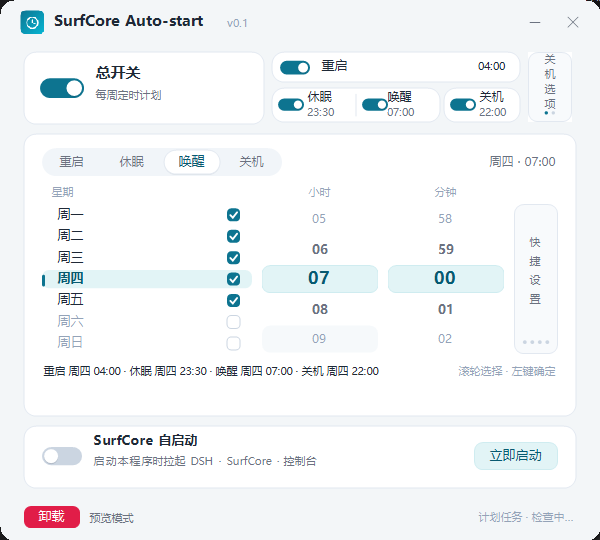

# SurfCore Auto-start

[](LICENSE)
[](https://github.com/MirLearn-perHsona/SurfCore-Auto-Start/actions/workflows/build.yml)
[](https://github.com/MirLearn-perHsona/SurfCore-Auto-Start/releases)

English | [简体中文](README.md)

**SurfCore Auto-start** is a small Windows scheduling utility that makes the **SurfCore** plugin for DeepSeek Harness more autonomous: after boot it starts DSH, SurfCore and SnowLuma in order, signs in to the SnowLuma console automatically, and injects the selected QQ process.

Its **scheduled power on/off feature works completely standalone** — it does not require DeepSeek Harness or SurfCore.



## Features

- **Weekly schedules**: configure each day from Monday to Sunday; weekday, hour and minute are selected with the mouse wheel in one compact panel and confirmed with a left click.
- **Quick setup**: apply the same power-on or power-off time to all 7 days with one click; master switches for power-on and power-off are independent.
- **Shutdown protection**: a cancellable 1-minute countdown before shutdown; shutdown is skipped when real keyboard/mouse activity occurred in the last 3 minutes.
- **SurfCore auto-start**: with the toggle enabled and the SnowLuma console token and QQ number filled in, start DSH → SurfCore bridge → SnowLuma → OneBot → QQ injection in the correct order.
- **Compact UI**: a 600×540 light, borderless window with custom-drawn switches and selectors.

## Usage

1. Download `SurfCore.Auto-start.exe` from [Releases](https://github.com/MirLearn-perHsona/SurfCore-Auto-Start/releases).
2. Recommended: place it in `C:\SurfCoreAutoStart\` and launch it from the desktop **SurfCore Auto-start** shortcut (the shortcut runs an elevated logon task).
3. Turn on the master switch and set the weekdays and power times; changes are written to Windows Task Scheduler automatically.
4. For SurfCore auto-start, enable its toggle, enter the **SnowLuma console token** and **QQ number**, and make sure QQ is already signed in with “Start with Windows” and “Auto sign-in” enabled.

> Do not double-click the exe directly from a chat app, a web page, or the H: drive — it may not receive administrator rights and cannot create scheduled tasks. Use the desktop shortcut instead.

## Scheduled power-on limitation

Windows Task Scheduler can wake the PC from **sleep / hibernation**, but it cannot power on a motherboard that is fully shut down. For a full power-on schedule, configure RTC Wake / Resume by Alarm in the BIOS/UEFI.

Check wake timers with:

```powershell
powercfg /waketimers
```

## Build

Requires Windows 10/11 x64 and .NET SDK 6.0+.

```powershell
dotnet build SurfCoreAutoStart.csproj -c Release
dotnet publish SurfCoreAutoStart.csproj -c Release -r win-x64 --self-contained true -p:PublishSingleFile=true
```

## AI-generated notice

> **All code and documentation in this project were generated entirely by deepseek-v4.1-Flash. Please review and verify them carefully.**
> There may be bugs, omissions or questionable design decisions. Inspect and test the project before relying on it.

## Contributors

- **MirLearn-perHsona** (author)

## License

[MIT License](LICENSE), Copyright (c) 2026 YG.
