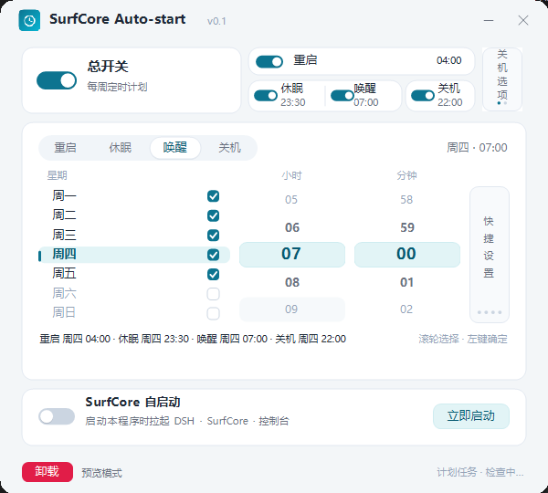
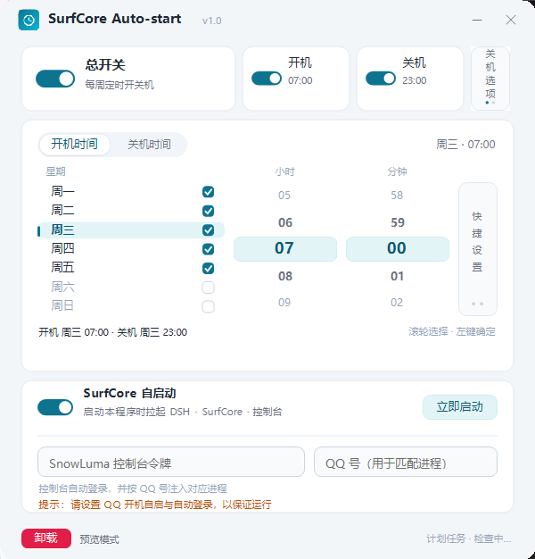

# SurfCore Auto-start

[](LICENSE)
[](https://github.com/MirLearn-perHsona/SurfCore-Auto-Start/actions/workflows/build.yml)
[](https://github.com/MirLearn-perHsona/SurfCore-Auto-Start/releases)

一个 Windows 小工具：**每周定时开关机** + **DeepSeek Harness / SurfCore / SnowLuma 一键启动**。

界面为 600×540 的无边框小窗（展开 SurfCore 区时为 600×626），浅色简洁风格，所有开关和滚轮选择器均为自绘。

## 项目介绍

**SurfCore Auto-start** 面向长期挂着 DeepSeek Harness 和 SurfCore 的 Windows 用户，把“什么时候开机、什么时候关机、开机后把整套服务拉起来”收进一个不到 1 MB 的小窗口里。

它解决三类重复操作：

- **定时开关机**：按周一至周日分别设置开机/关机时间，支持睡眠/休眠唤醒，支持“每天时间一致”的快捷设置。
- **关机保护**：关机前 1 分钟倒计时可取消；检测到最近 3 分钟有真实键鼠操作时自动跳过本次关机，避免打断正在使用电脑的人。
- **服务一键启动**：按 DeepSeek Harness → SurfCore bridge → SnowLuma → OneBot → QQ 进程注入的正确顺序启动，并自动登录 SnowLuma 控制台。

适合这些场景：

- 家里/实验室的常开机器，需要按作息自动开关机；
- 用 DeepSeek Harness + SurfCore + SnowLuma 做 QQ 机器人，希望开机后自动恢复整套环境；
- 不希望每次都手动点“一键启动 SurfCore”、输入控制台令牌、选 QQ 进程再点加载。

项目使用 C# WinForms + .NET 6，单文件发布，不需要安装额外框架（自包含版）；默认不收集、不上传任何数据，SnowLuma 控制台令牌使用 Windows DPAPI 加密后仅保存在本机。





---

## 下载与安装

- GitHub 仓库：<https://github.com/MirLearn-perHsona/SurfCore-Auto-Start>
- 发布页（exe 下载）：<https://github.com/MirLearn-perHsona/SurfCore-Auto-Start/releases>
- 克隆源码：

```powershell
git clone https://github.com/MirLearn-perHsona/SurfCore-Auto-Start.git
cd SurfCore-Auto-Start
dotnet build SurfCoreAutoStart.csproj -c Release
```

正式使用建议把 exe 放到 `C:\SurfCoreAutoStart\`，再通过桌面快捷方式调用高权限登录任务启动，具体见下文“Windows 登录自启动”一节。

---

## 功能

### 1. 每周定时开关机

- 周一至周日分别设置是否启用、开机时间、关机时间。
- 星期选择：鼠标滚轮上下移动高亮行；左键点复选框可直接勾选/取消，左键点当前高亮行也可切换启用。
- 小时 / 分钟：滚轮上下调整，左键点某一行直接选值。
- 快捷设置（时间卡右侧竖条）：
  - **开机时间每天一致**：7 天的开机时间统一为当前选中日的时间。
  - **关机时间每天一致**：7 天的关机时间统一为当前选中日的时间。
  - 两个开关互相独立：可以只统一开机、只统一关机，或两个都开；不会再让关机时间跟随开机时间。
- 总开关宽度是开机/关机分开关的 2 倍；总开关关闭时保留各分开关状态，但会删除系统计划任务。
- 开机、关机可分别关闭。

### 2. 关机选项竖条

电源行最右侧有一个和“快捷设置”同款的竖条，点开后有两个选项（只对定时关机生效）：

- **关机倒计时提醒**：关机前 1 分钟弹出倒计时窗口，可以点“取消关机”，也可以点“立即关机”。
- **在线时不关机**：到关机时间时检查最近 3 分钟是否有键盘/鼠标操作；有人在使用就跳过本次关机。
  - 通过低级键鼠钩子识别输入，带 `LLKHF_INJECTED` / `LLMHF_INJECTED` 标记的自动输入（如自动化脚本、AI 操作）不计入“有人在用”，只有真实键鼠操作才会阻止关机。
  - 计划任务会提前 60 秒（只开倒计时）或 180 秒（开了在线不关机）启动本程序的 `--shutdown-guard` 模式，先隐藏等待，到点再判断/倒计时。

程序通过 Windows 任务计划程序创建两个任务：

| 任务 | 作用 |
| --- | --- |
| `SurfCoreAutoStart-Boot` | 在设定的星期/时间唤醒电脑（睡眠或休眠） |
| `SurfCoreAutoStart-Shutdown` | 在设定的星期/时间执行关机；按关机选项提前 60/180 秒启动 guard |

任务使用当前用户、交互式登录、`WakeToRun=true`。通常不需要管理员权限；如果系统策略或安全软件拦截任务创建，程序会弹出“计划任务同步失败”的具体原因，并在需要时询问是否以管理员身份重启（只需授权这一次，之后启动会直接复用已有任务状态）。

### 3. SurfCore 自启动

打开 **SurfCore 自启动** 后，下方展开控制台令牌和 QQ 号输入区：

- **SnowLuma 控制台令牌**：SnowLuma 控制台的访问凭据（旧称 WebUI 密码，不是 QQ 密码），用 Windows DPAPI 加密后保存在本机。
- **QQ 号**：用于在 SnowLuma 的进程列表里匹配已经登录的 QQ 进程。
- 勾选后会显示提示：**请设置 QQ 开机自启与自动登录以保证运行**。

开启后，启动本程序会按以下顺序执行（与 SurfCore 概览里的“一键启动 SurfCore”一致）：

1. 如果 DeepSeek Harness 没在运行，启动 DeepSeek Harness（程序会自动探测安装路径，也可在 `config.json` 的 `dshPath` 中指定）；然后运行 `scripts\sync-dsh-port.mjs` 探测 Harness 的真实 Web 端口，并确认 Harness 页面可访问。**Harness 没就绪就中止，不会先启动 SnowLuma。**
2. 如果 SurfCore bridge 端口（默认 3100）没在监听，隐藏启动 `src\bridge.js`。
3. 如果 SnowLuma 端口（默认 5099）没在监听，启动 SnowLuma 的 `index.mjs`。
4. 等 SnowLuma 控制台、以及 OneBot 的 3000/3001 端口就绪（QQ 已登录）后，才查询 QQ 进程，避免“查询比 SnowLuma 启动还早”。
5. 调用 SnowLuma `POST /api/login` 获取登录 token。
6. 按 QQ 号匹配 `/api/processes` 中的 QQ 进程，并调用 `/api/processes/{pid}/load` 注入。
7. 用 Edge 打开 `http://127.0.0.1:5099/`，通过 CDP 把 token 写入 `localStorage['snowluma_token']`，实现自动登录。

> QQ 进程注入依赖 QQ 客户端已经登录；请同时开启 QQ 的“开机自启”和“自动登录”，否则程序只能打开控制台，无法自动注入。

> 这个开关的“自启动”指**随本程序启动**。本程序本身会在每次启动时写入当前用户的 Windows 登录自启项（见下一节），所以登录 Windows 后程序会自动运行；只有打开本开关，才会继续拉起 DSH / SurfCore / SnowLuma。

**立即启动** 按钮会立刻执行同一套流程，不依赖开机自启开关。

#### 关于 QQ 密码

SnowLuma 没有提供 QQ 账号密码登录接口，QQ 客户端本身也不支持由外部程序安全地代填密码。因此本程序：

- 不会保存或代填 QQ 密码；
- 只要求 QQ 客户端**已经登录**，然后用 QQ 号找到对应进程并注入；
- 自动填写的是 **SnowLuma 控制台令牌**，用于免去每次打开控制台都要手动登录。

如果点击启动时 QQ 还没登录，程序会在状态栏提示先登录 QQ，控制台仍会打开。

### 4. Windows 登录自启动

本程序需要**管理员权限**才能创建 Windows 计划任务，因此不能只靠用户级 Run 键启动。当前部署使用一个高权限登录任务：

- 任务名：`SurfCoreAutoStart-App`
- 触发：当前用户登录时
- 权限：`Run with highest privileges`（最高权限）
- 动作：`cmd.exe /c C:\SurfCoreAutoStart\start.bat`
- `start.bat` 会直接运行 `C:\SurfCoreAutoStart\SurfCore Auto-start.exe` 并保持等待，保证程序不会被任务结束后回收。

登录 Windows 后任务会自动以高权限启动本程序，SurfCore 自启动链因此有入口。程序检测到该任务存在时，会主动删除旧的 HKCU Run 值，避免双启动。

桌面上的 **SurfCore Auto-start** 快捷方式通过 `schtasks /Run /TN "SurfCoreAutoStart-App"` 启动同一个高权限任务。如果快捷方式或任务丢失，可在管理员 PowerShell 中重建：

```powershell
$exe = 'C:\SurfCoreAutoStart\SurfCore Auto-start.exe'
$bat = 'C:\SurfCoreAutoStart\start.bat'
New-Item -ItemType Directory -Force 'C:\SurfCoreAutoStart' | Out-Null
Copy-Item $exe 'C:\SurfCoreAutoStart\SurfCore Auto-start.exe' -Force
Set-Content $bat "@echo off`r`n`"$exe`""
schtasks /Create /TN "SurfCoreAutoStart-App" /SC ONLOGON /RL HIGHEST /TR "cmd.exe /c `"$bat`"" /F
```

> 普通权限启动的实例会提示“当前启动方式没有管理员权限”，然后自动退出；请使用桌面快捷方式，或重新登录让高权限任务启动。程序只允许运行一个实例，重复双击不会覆盖高权限实例。

### 5. 卸载程序

主窗口左下角有红色的 **卸载** 按钮。点击后需要两次确认：

1. “是否确定卸载？”
2. “卸载将还原所有已修改设置至初始状态。”

确认后会：

- 删除 `SurfCoreAutoStart-Boot` / `SurfCoreAutoStart-Shutdown` 计划任务；
- 删除 Windows 登录自启项；
- 删除配置与日志目录 `%APPDATA%\SurfCore Auto-start`；
- 删除 Edge 自动登录用的缓存目录 `%LOCALAPPDATA%\SurfCore Auto-start`；
- 删除程序自身的 exe 及同目录下的程序文件；
- 如果程序所在目录里**只有本程序文件**，会连同该目录一起删除；如果目录里还有源码、其他软件或用户文件，则只删本程序文件，避免误删。

删除脚本在程序退出后执行；计划任务因权限不足删不掉时，会提示你到“任务计划程序”手动删除。

---

## 使用

1. 运行 `SurfCore Auto-start.exe`。
2. 先打开总开关，再按需要调整星期和时间；改完立即生效（约 0.5 秒防抖后写入并同步计划任务）。
3. 需要 SurfCore 自启动时，打开第三个开关，填好 SnowLuma 控制台令牌和 QQ 号。
4. 关闭窗口即退出；计划任务已经写入 Windows，退出程序不影响定时开关机。

### 界面交互

- 拖动标题栏空白处移动窗口。
- 右上角为最小化 / 关闭。
- 时间卡顶部切换 **开机时间 / 关机时间**。
- 底部左侧显示操作结果，右侧显示计划任务同步状态。

---

## 重要限制

### 定时开机不是"从完全关机状态开机"

Windows 计划任务的 `WakeToRun` 可以让电脑从**睡眠 / 休眠**中唤醒，但**不能把已经完全关机的主板重新上电**。

如果需要在完全关机后定时开机，必须在主板 BIOS/UEFI 中设置 **RTC Wake / Resume by Alarm**（不同主板叫法不同），并在 Windows 中关闭"快速启动"以确保休眠/关机状态符合预期。

另外请在电源计划中允许唤醒定时器：

```powershell
powercfg /waketimers
```

如果这里看不到任务，检查：

- 电源选项 → 睡眠 → 允许使用唤醒定时器；
- 主板 BIOS 是否禁用了 RTC 唤醒；
- 笔记本是否使用电池（任务已设置 `DisallowStartIfOnBatteries=false`，但部分厂商电源管理仍会拦截）。

### 关机任务不会补跑

关机任务设置了 `StartWhenAvailable=false`：如果设定时间电脑处于关机/睡眠错过，恢复后不会立刻补一次关机，避免刚开机就被关掉。

### 时间冲突

如果"开机时间"和"关机时间"设成同一时刻，电脑可能在刚唤醒后又收到关机命令。快捷设置里已给出提示，请不要这样配置。

---

## 配置文件与日志

| 内容 | 路径 |
| --- | --- |
| 配置 | `%APPDATA%\SurfCore Auto-start\config.json` |
| 日志 | `%APPDATA%\SurfCore Auto-start\logs\app-yyyyMMdd.log` |
| 任务 XML（临时） | `%TEMP%\SurfCoreAutoStart\boot.xml`、`shutdown.xml`（创建任务后立即删除） |

- 控制台令牌只保存 DPAPI 密文，只有同一 Windows 用户能解密。
- 配置里的路径可以在程序自动探测失败时手动修改。
- 关闭总开关或点击左下角“卸载”都能移除计划任务；只删配置目录不会删除系统任务。

---

## 构建

要求：Windows 10/11 x64、.NET SDK 6.0+。

```powershell
dotnet build SurfCoreAutoStart.csproj -c Release
dotnet publish SurfCoreAutoStart.csproj -c Release -r win-x64 --self-contained false -p:PublishSingleFile=true
```

产物：

```
bin\Release\net6.0-windows\win-x64\publish\SurfCore Auto-start.exe
```

这是框架依赖的单文件 exe，需要安装 **.NET 6 Desktop Runtime**（本机已安装）。如果要发给没有运行时的电脑，可改用：

```powershell
dotnet publish SurfCoreAutoStart.csproj -c Release -r win-x64 --self-contained true -p:PublishSingleFile=true
```

自包含版本体积会大很多，但可以直接运行。

---

## 常见问题

**状态栏显示"计划任务 · 未启用"？**
总开关关闭，或者开机/关机分开关都关闭，或者没有勾选任何星期。

**状态栏显示"计划任务 · 同步失败"是什么意思？**
程序没能把设置写入 Windows 任务计划程序，因此自动开机/关机不会生效。绝大多数情况是**权限问题**：本程序必须运行在“高完整性/管理员”令牌下，普通双击产生的进程（尤其是从浏览器、聊天软件、DSH 或沙箱里点开的进程）可能只有 Medium 权限，Windows 会拒绝 `schtasks` 和计划任务 COM 写入，错误是 `拒绝访问 (0x80070005)`。请关闭所有旧窗口，改用桌面 **SurfCore Auto-start** 快捷方式（它会启动高权限任务）；程序同一时间只允许一个实例，旧 Medium 实例不会覆盖高权限实例。其他原因包括安全软件拦截、任务计划服务异常或任务 XML 被组策略拒绝。程序会弹出具体原因；新版已把任务 XML 改到系统临时目录，不再依赖 `%APPDATA%` 的写权限。

**提示"SnowLuma 控制台令牌错误"？**
程序会改为直接打开控制台，请在浏览器里手动登录。注意 SnowLuma 连续登录失败 5 次会锁定 15 分钟。

**提示"未找到 QQ ... 的进程"？**
先打开 QQ 并完成登录，再点"立即启动"。程序不会代替 QQ 登录。

**自动登录没有生效？**
确认系统里有 Edge；程序会使用一个独立的 Edge 配置目录并开启远程调试端口。若 CDP 被安全软件拦截，会自动回退为直接打开控制台，手动登录一次即可。

**端口被占用？**
默认 SnowLuma 5099、SurfCore 3100；可在 `config.json` 里改 `snowLumaPort` / `surfCorePort`。DSH 路径也可在 `dshPath` 中修改。

---

## 文件结构

```
SurfCoreAutoStart/
├─ Program.cs            入口、--apply / --screenshot 辅助模式
├─ MainForm.cs           主窗口布局与交互
├─ Controls.cs           自绘开关、滚轮、快捷弹窗等控件
├─ Theme.cs              颜色、字体、圆角绘制
├─ Config.cs             配置模型、DPAPI、路径探测
├─ Scheduler.cs          Windows 计划任务创建/删除
├─ ShutdownGuard.cs      关机倒计时 / 在线不关机判断窗口
├─ Startup.cs            Windows 登录自启动注册
├─ LaunchService.cs      DSH / SurfCore / SnowLuma 启动与 QQ 注入
├─ BrowserInjector.cs    Edge CDP 自动登录
├─ Native.cs             Win32 / DPAPI P/Invoke
├─ app.manifest / app.ico
├─ LICENSE               MIT License
├─ docs/                 界面截图
└─ README.md
```

---

## 发布到 Git / Releases

仓库地址：<https://github.com/MirLearn-perHsona/SurfCore-Auto-Start>

源码可以直接同步到 GitHub 或 Gitee。`bin/`、`obj/`、`preview/`、`.vs/`、`*.user` 已在 `.gitignore` 中忽略。

```powershell
git init -b main
git add .
git commit -m "SurfCore Auto-start v1.0.0"
git remote add origin https://github.com/MirLearn-perHsona/SurfCore-Auto-Start.git
git push -u origin main
```

仓库内置了 GitHub Actions 工作流 `.github/workflows/build.yml`：

- push 到 `main` 或手动触发时，自动构建自包含单文件 exe，并上传为 Actions artifact；
- push `v*` 标签时，自动创建 GitHub Release 并附带 exe。

```powershell
git tag v1.0.0
git push origin v1.0.0
```

exe 不建议提交进仓库（体积大且每次构建都会变化）。发布时在 GitHub/Gitee 的 **Releases** 页新建版本，上传 `SurfCore Auto-start.exe`，并附上构建说明和 SHA256 即可。

如果要让用户直接下载，建议使用 **自包含 publish**（README 的“构建”一节），这样对方不需要预装 .NET 6 Desktop Runtime。

---

## 许可证

本项目使用 [MIT License](LICENSE) 开源，Copyright (c) 2026 YG。

你可以自由使用、修改、分发和商用，只需保留版权声明和许可证文本。
